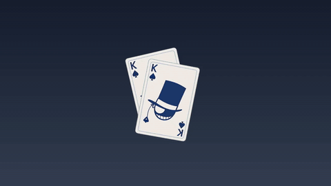

# kaito-kid-pet

怪盗基德透明桌宠，基于 Electron、Vue 3 和 TypeScript，支持 Windows 和 macOS。

## 预览

[](docs/kaito-kid-preview.mp4)

[观看完整变身视频（含原声）](docs/kaito-kid-preview.mp4)

预览使用展示背景，实际桌宠窗口背景透明。

## 功能

- 待机固定显示第一帧扑克牌，不循环动画、不播放声音。
- 双击播放约 10.04 秒的原声变身，结束后回到第一帧；播放中不会重复启动。
- 支持拖动、局部 Q 弹按压和松开回弹。
- 开启“双击分身”后，双击生成分身，分身带原声变身、随机高抛物线出场及落地回弹；最多 10 个分身，支持一键清空。
- 托盘和桌宠右键菜单共用操作，“变身一次”让所有已就绪实例播放；音量、大小、置顶及显示状态统一设置。
- 保留按窗口大小/DPI 选择素材、受限帧缓存和解码并发等性能优化。

## 运行

需要 Node.js 22.12 或更高版本。

```sh
npm ci
npm run dev
```

开发端口为 `127.0.0.1:5174`。本项目有独立名称、应用 ID 和用户设置，不覆盖其他桌宠。

## 打包

```sh
npm run dist:win
npm run dist:mac  # 需在 Mac 上执行
```

安装包输出到 `release/`；macOS 支持 Apple Silicon 和 Intel。新构建成功后清理旧安装包。

## 素材与许可证

变身素材由用户提供，从绿幕视频提取 241 张透明帧并保留原声，保留白色礼服、扑克牌和羽毛特效。角色、视频、音频及相关图案权利归原权利人，不将其声明为开源代码素材。

代码沿用 [Apache-2.0](LICENSE)，素材说明见 [第三方素材声明](THIRD_PARTY_NOTICES.md)。运行与维护说明见 [开发文档](docs/DEVELOPMENT.md)。
